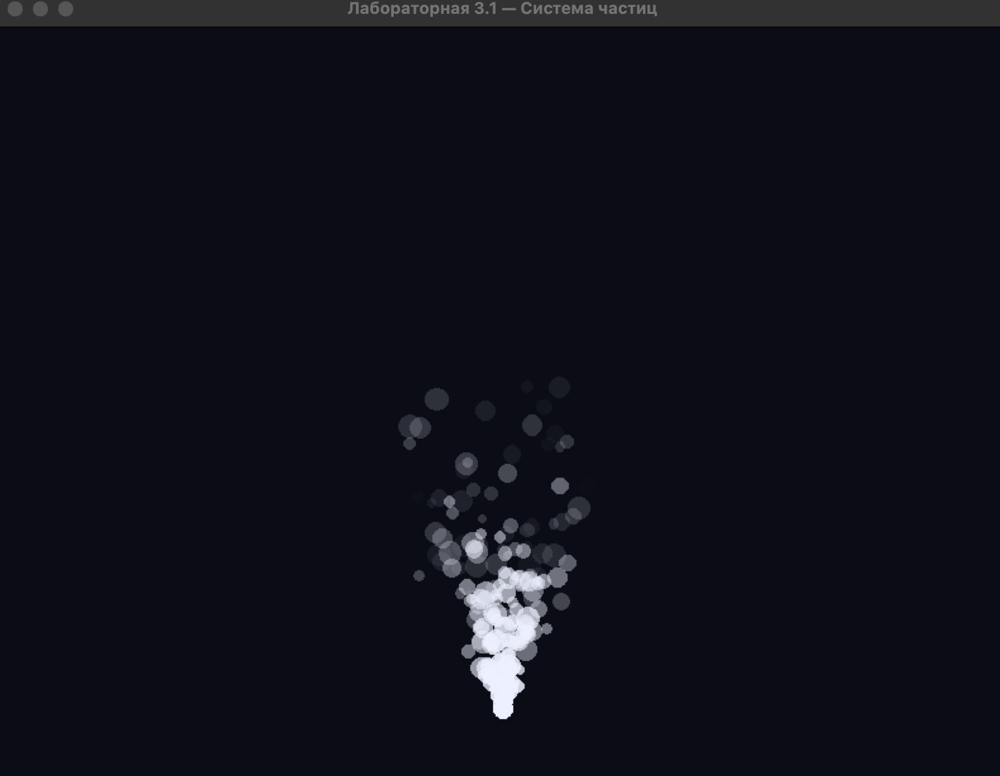

# Лабораторная работа 3.1 — Простая анимация

**Автор:** Рябов Максим Алексеевич  
**Группа:** ПИ25-3  
**Дисциплина:** Практикум по программированию  
**Вариант:** 13 — Система частиц

## Описание проекта

Графическое приложение на Python для визуализации
системы частиц с использованием tkinter и Pillow.

Частицы представляют собой небольшие круги, которые
появляются в заданной точке, движутся со случайной
скоростью и постепенно исчезают.

Каждая частица имеет ограниченный срок жизни.
По мере уменьшения оставшегося времени жизни
уменьшается её прозрачность.

## Реализованные возможности

- Генерация частиц со случайными параметрами.
- Анимация движения частиц.
- Отображение частиц в виде кружков.
- Ограниченный срок жизни каждой частицы.
- Плавное уменьшение непрозрачности.
- Автоматическое удаление завершивших жизнь частиц.
- Постоянный источник частиц в нижней части окна.
- Создание дополнительных источников щелчком мыши.
- Автоматическое удаление завершённых временных систем.

## Управление

**Левая кнопка мыши** — создать новую систему частиц
в выбранном месте окна.

**Закрытие окна** — завершить программу.

## Технологии

- Python 3.9+
- tkinter
- Pillow 11.3.0
- unittest

## Установка и запуск

1. Клонировать репозиторий:

   ```bash
   git clone https://github.com/Framyrite/ppp_lab3.1_simple_animation.git
   cd ppp_lab3.1_simple_animation
   ```

2. Создать виртуальное окружение:

   ```bash
   python3 -m venv venv
   ```

3. Активировать окружение на macOS или Linux:

   ```bash
   source venv/bin/activate
   ```

4. Установить зависимости:

   ```bash
   python -m pip install -r requirements.txt
   ```

5. Запустить приложение:

   ```bash
   python main.py
   ```

## Тестирование

Для запуска всех тестов выполнить:

```bash
python -m unittest discover -s tests -v
```

## Структура проекта

```text
ppp_lab3.1_simple_animation/
├── main.py
├── README.md
├── requirements.txt
├── .gitignore
├── screenshots/
│   └── main_window.png
├── src/
│   ├── __init__.py
│   ├── app.py
│   ├── models/
│   │   ├── __init__.py
│   │   ├── particle.py
│   │   └── particle_system.py
│   └── renderers/
│       ├── __init__.py
│       └── renderer.py
└── tests/
    ├── __init__.py
    ├── test_particle.py
    └── test_particle_system.py
```

## Математическая модель

Положение частицы обновляется по формулам:

- x = x + vx × dt
- y = y + vy × dt

где vx и vy — компоненты скорости,
dt — время между обновлениями.

Непрозрачность рассчитывается по формуле:

alpha = 255 × (remaining_lifetime / max_lifetime)

При появлении частица непрозрачная (alpha = 255).
В конце жизни частица полностью исчезает (alpha = 0).

## Скриншот



## Статус

Основной функционал и оба дополнительных задания
варианта 13 реализованы.
